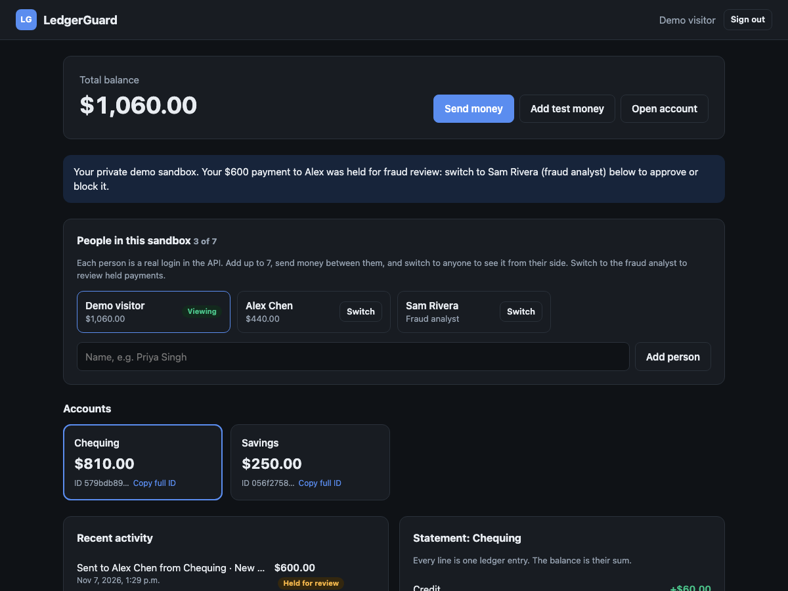
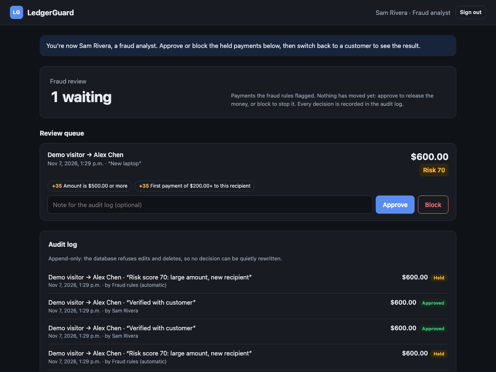

# LedgerGuard

A payments API in **Java 21 + Spring Boot** that moves money the way a bank should: it never loses money, never charges twice, never overdraws, and holds suspicious payments for a fraud analyst.




## What makes it interesting

- **Double-entry ledger.** There is no balance column. Every transfer writes a debit and a matching credit, and a balance is the sum of its entries. A Postgres trigger rejects any transaction whose entries don't sum to zero, even if the Java code has a bug.
- **Safe retries.** Each payment carries an `Idempotency-Key`. Retrying the same request returns the original result instead of charging twice.
- **No race conditions.** Accounts are locked (`SELECT … FOR UPDATE`) in a fixed order, so 50 simultaneous payments can't overdraw an account and opposite transfers can't deadlock.
- **Fraud review.** Rules score each payment; risky ones are held with no money moved until an analyst approves or blocks them. Every decision goes to an audit log the database won't let anyone edit.

## Fraud rules

A payment with **60+ points** is held. One signal alone is normal; two together look like fraud.

| Signal | Points |
|---|---|
| Amount is $500 or more | 35 |
| First $200+ payment to this recipient | 35 |
| 5+ payments from the account in 10 minutes | 30 |
| Sends 90%+ of the balance | 25 |

Approving re-checks the balance (a hold doesn't reserve money), and only one analyst's decision can count. Customers see that a payment is held, never the rules that flagged it.



## Try it

```bash
docker compose up --build
```

Open **http://localhost:8080** and click **Try the demo, no sign-up**. You get a private sandbox with sample people and a payment already held for review:

1. **Send money** to another person, then click **Retry this exact request**. The money moves once.
2. Click **Switch** on **Sam Rivera (fraud analyst)** and approve or block the held payment.
3. Switch back to see the result on the customer's side.

No Docker? See [Run without Docker](#run-without-docker). API docs: http://localhost:8080/swagger-ui.html

## Tests

**64 tests** (JUnit 5 + Testcontainers against a real Postgres), run in CI on every push. The ones that matter most:

- **50 simultaneous $10 payments** from a $100 account: exactly 10 settle and the balance ends at $0.00. Removing the lock makes this test fail.
- **10 analysts approve one held payment at the same instant:** exactly one succeeds and the money moves once.
- **The whole ledger sums to zero** after every kind of transfer, approval, block and rejection.

```bash
./mvnw verify    # needs Docker for Testcontainers
```

## Where to look in the code

| File | What it does |
|---|---|
| `transfer/TransferService.java` | The money flow: idempotency, locking, balance check, fraud scoring |
| `fraud/FraudRules.java` | The fraud rules (pure Java, unit-tested at every threshold) |
| `db/migration/V1__ledger.sql` | Ledger tables and the triggers that keep money correct |
| `ConcurrencyTest.java` | The race-condition tests |

## Tech

Java 21, Spring Boot (Web, Data JPA, Security), PostgreSQL, Flyway, JWT auth, Testcontainers, Docker, GitHub Actions. The web app is plain HTML/CSS/JavaScript.

## Roadmap

1. ✅ Ledger core: double-entry ledger, idempotent transfers, locking, auth
2. ✅ Fraud engine: risk scoring, analyst review queue, audit log
3. Async fraud checks (AWS SQS) and a public cloud deployment
4. Richer analyst dashboard and a traffic simulator that plants fraud patterns

## Run without Docker

Needs Java 21+ and Postgres:

```bash
createdb ledgerguard
DATABASE_URL=jdbc:postgresql://localhost:5432/ledgerguard DATABASE_USERNAME=$USER \
JWT_SECRET=any-string-of-at-least-32-characters ./mvnw spring-boot:run
```

Tests without Docker: add `TEST_DATABASE_URL=jdbc:postgresql://localhost:5432/ledgerguard_test TEST_DATABASE_USERNAME=$USER` before `./mvnw verify`.
