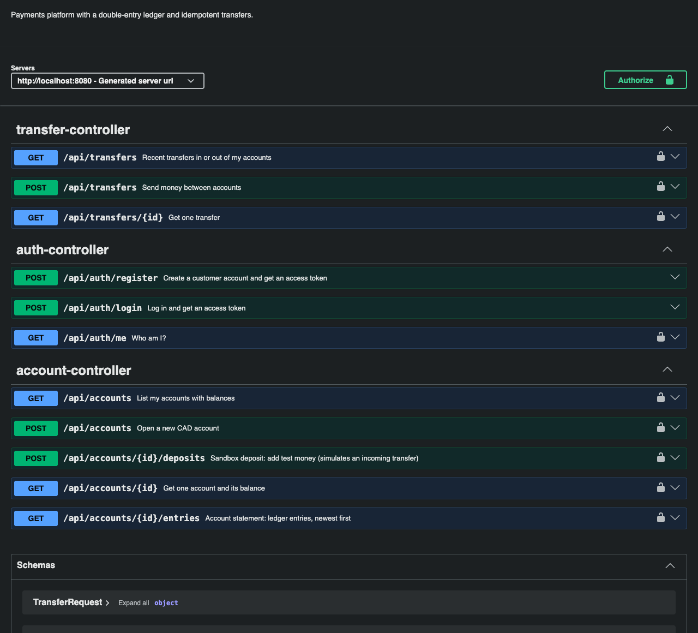

# LedgerGuard

A payments API in **Java 21 + Spring Boot 4** that moves money the way banks do: a **double-entry ledger**, **idempotent** transfers that can be retried safely, and **row locking** so simultaneous requests can never overdraw an account.




> **Status:** Phase 1 of 4. The ledger, transfers, auth and tests are done. Next up: a fraud-detection engine that holds suspicious transfers for review (see [Roadmap](#roadmap)).

## What it does

- **Accounts:** customers open CAD accounts and view balances and statements.
- **Transfers:** send money between accounts with an `Idempotency-Key`. A transfer either **settles** or is **rejected** (for example `INSUFFICIENT_FUNDS`). Either way it is recorded.
- **Sandbox deposits:** add test money, simulating an incoming transfer from outside.
- **Auth:** register and log in to get a JWT. Roles: `CUSTOMER`, `ANALYST`, `ADMIN`. Analysts can view any account, which the fraud-review phase will use.

## How it keeps money correct

| Problem | How LedgerGuard handles it | Where |
|---|---|---|
| Balances drifting or being edited | No balance column. A balance is the **sum of ledger entries**, and every transfer writes a debit and a matching credit. | `LedgerEntryRepository.balanceOf` |
| Half-written transfers | A Postgres **deferred constraint trigger** rejects any transaction whose entries don't sum to zero, even if the Java code has a bug. | `V1__ledger.sql` |
| Rewriting history | The ledger is **append-only**: the database rejects `UPDATE` and `DELETE` on entries. | `V1__ledger.sql` |
| Double charges when a client retries | `Idempotency-Key` header. A retry with the same key returns the original result (`200`, `Idempotent-Replayed: true`). The same key with a *different* request is refused (`422`). | `TransferService`, `RequestFingerprint` |
| Two requests spending the same money | `SELECT … FOR UPDATE` on the accounts, so transfers on one account run one at a time. | `AccountRepository.findByIdForUpdate` |
| Deadlocks (A→B and B→A at once) | Accounts are always locked in the **same order** (by id). | `TransferService.transfer` |
| Floating-point rounding | `BigDecimal` with exactly 2 decimals, and amounts sent in JSON as **strings** (`"40.25"`). | `Money` |
| Probing other people's accounts | Someone else's account returns `404`, not `403`. Login gives the same error for an unknown email and a wrong password. | `AccountService`, `AuthService` |

## Tests

35 tests: JUnit 5 unit tests, plus integration tests that start the real app against a real Postgres using **Testcontainers**.

The concurrency tests are the most important ones:

- **50 simultaneous $10 transfers** from an account holding $100 → exactly 10 settle, 40 are rejected, and the balance ends at $0.00. This is repeated 5 rounds. With the row lock removed, the test fails, so it really detects the race.
- **20 simultaneous retries with one Idempotency-Key** → money moves exactly once.
- **50 transfers in opposite directions at once** → no deadlocks, and balances are unchanged.
- **Ledger invariants:** the whole ledger sums to zero, entries can't be edited or deleted, and unbalanced entries are rejected at commit.

```bash
./mvnw verify          # needs Docker running (Testcontainers starts Postgres)
```
No Docker? Point the tests at any Postgres database instead:
```bash
TEST_DATABASE_URL=jdbc:postgresql://localhost:5432/ledgerguard_test TEST_DATABASE_USERNAME=$USER ./mvnw verify
```

## Run it

**With Docker** (API + Postgres):
```bash
docker compose up --build
```
Then open http://localhost:8080/swagger-ui.html.

**Without Docker** (needs Java 21+ and a local Postgres):
```bash
createdb ledgerguard
DATABASE_URL=jdbc:postgresql://localhost:5432/ledgerguard DATABASE_USERNAME=$USER \
JWT_SECRET=any-string-of-at-least-32-characters ./mvnw spring-boot:run
```

| Variable | Meaning |
|---|---|
| `DATABASE_URL` | JDBC URL, e.g. `jdbc:postgresql://host:5432/db?sslmode=require` |
| `DATABASE_USERNAME` / `DATABASE_PASSWORD` | Database login |
| `JWT_SECRET` | At least 32 characters; used to sign access tokens |
| `PORT` | HTTP port (default 8080) |

Flyway creates the schema on startup.

## Try it with curl

```bash
API=http://localhost:8080

# 1. Register and keep the token
TOKEN=$(curl -s -X POST $API/api/auth/register -H 'Content-Type: application/json' \
  -d '{"email":"alice@example.com","password":"correct-horse-battery","fullName":"Alice"}' | jq -r .accessToken)

# 2. Open two accounts
A=$(curl -s -X POST $API/api/accounts -H "Authorization: Bearer $TOKEN" -H 'Content-Type: application/json' -d '{"name":"Chequing"}' | jq -r .id)
B=$(curl -s -X POST $API/api/accounts -H "Authorization: Bearer $TOKEN" -H 'Content-Type: application/json' -d '{"name":"Savings"}' | jq -r .id)

# 3. Add sandbox money
curl -s -X POST $API/api/accounts/$A/deposits -H "Authorization: Bearer $TOKEN" \
  -H "Idempotency-Key: $(uuidgen)" -H 'Content-Type: application/json' -d '{"amount":"500.00"}'

# 4. Transfer, then send the exact same request again: the second one is a replay, not a second charge
KEY=$(uuidgen)
for i in 1 2; do
  curl -s -i -X POST $API/api/transfers -H "Authorization: Bearer $TOKEN" -H "Idempotency-Key: $KEY" \
    -H 'Content-Type: application/json' -d "{\"fromAccountId\":\"$A\",\"toAccountId\":\"$B\",\"amount\":\"120.50\"}" | head -1
done
# HTTP/1.1 201
# HTTP/1.1 200   (Idempotent-Replayed: true)
```

## API

Full interactive docs are at `/swagger-ui.html`; the OpenAPI spec is at `/v3/api-docs`.

| Method | Path | Description |
|---|---|---|
| `POST` | `/api/auth/register` | Create a customer and get a JWT |
| `POST` | `/api/auth/login` | Log in and get a JWT |
| `GET` | `/api/auth/me` | Current user |
| `POST` | `/api/accounts` | Open a CAD account |
| `GET` | `/api/accounts` | My accounts with balances |
| `GET` | `/api/accounts/{id}` | One account and its balance |
| `GET` | `/api/accounts/{id}/entries` | Statement (ledger entries, newest first, paginated) |
| `POST` | `/api/accounts/{id}/deposits` | Sandbox deposit (max 1,000.00), needs `Idempotency-Key` |
| `POST` | `/api/transfers` | Send money, needs `Idempotency-Key` |
| `GET` | `/api/transfers` | Recent transfers in or out of my accounts |
| `GET` | `/api/transfers/{id}` | One transfer |

Errors use [RFC 9457 problem details](https://www.rfc-editor.org/rfc/rfc9457) with a stable `code`:
```json
{ "status": 422, "detail": "This Idempotency-Key was already used for a different request.", "code": "IDEMPOTENCY_KEY_REUSED" }
```

## Tech stack

| Layer | Tech |
|---|---|
| Language / framework | Java 21, Spring Boot 4 (Web MVC, Data JPA, Security, Validation) |
| Database | PostgreSQL, Flyway migrations, Hibernate (schema validated against migrations) |
| Auth | Spring Security OAuth2 Resource Server, HS256 JWTs, BCrypt |
| API docs | springdoc-openapi (Swagger UI) |
| Tests | JUnit 5, AssertJ, Testcontainers |
| Delivery | Docker, Docker Compose, GitHub Actions |

## Roadmap

1. ✅ **Ledger core:** accounts, double-entry ledger, idempotent transfers, JWT auth, concurrency tests, Docker, CI
2. **Fraud engine:** rules such as velocity, unusual amount and new payee + large amount produce a risk score. Risky transfers go to `HELD` and appear in an analyst review queue (approve or block), with every decision in an audit log.
3. **Async + cloud:** fraud checks via AWS SQS. Deploy as a Docker image on AWS Lambda, with Postgres on Neon (all free tier).
4. **Dashboard + simulator:** a React analyst dashboard and a traffic generator that plants realistic fraud patterns.
